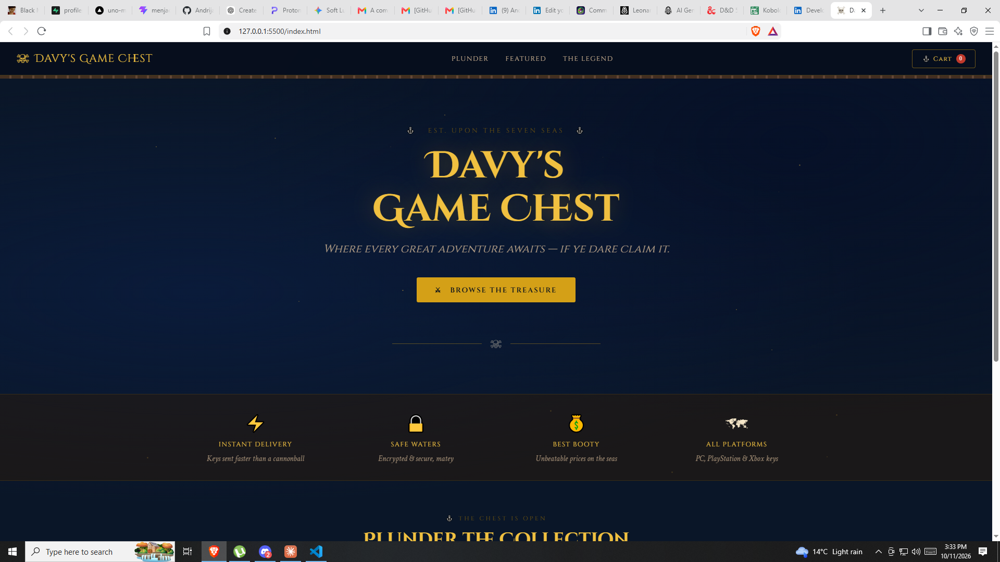
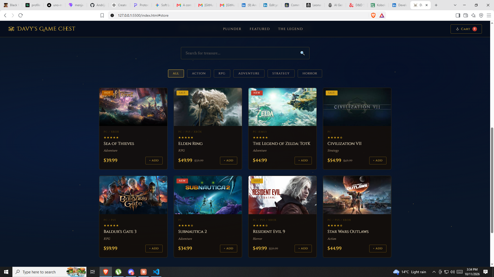
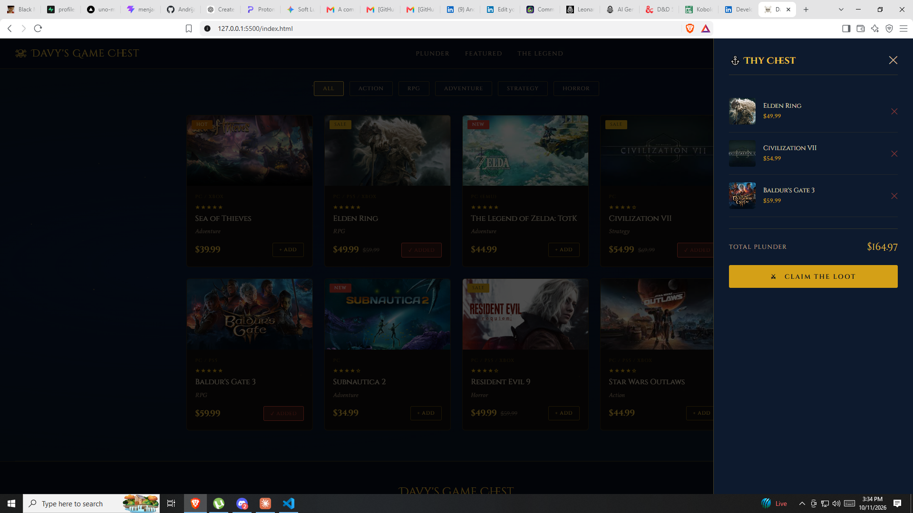

# 🎮 Video Game E-commerce Website

An online store for video games, designed and built from scratch as my web design thesis project at the Belgrade Academy of Business and Art Vocational Studies (BAPUS).

🔗 **Live demo:** [andrija369.github.io/game-store-website](https://andrija369.github.io/game-store-website/)



## ✨ Features

- Responsive layout that works on desktop, tablet and mobile
- Product catalog with game cards (cover, title, price)
- Product pages with details, images and an "Add to cart" button
- Shopping cart with selected games and the total price
- Interactive features written in vanilla JavaScript (no frameworks)

## 🛠️ Built with

- **HTML5**: page structure
- **CSS3**: layout, styling and responsive design
- **JavaScript**: interactivity and cart logic

## 📸 Screenshots

| Home | Product page | Cart |
|------|--------------|------|
|  |  |  |

## 🚀 Run locally

```bash
git clone https://github.com/Andrija369/game-store-website.git
cd game-store-website
```

Then open `index.html` in your browser. No build step or installation needed.

## 👤 Author

**Andrija Sremcev**, Frontend Developer
[LinkedIn](https://www.linkedin.com/in/andrija-sremcev) · [GitHub](https://github.com/Andrija369)
